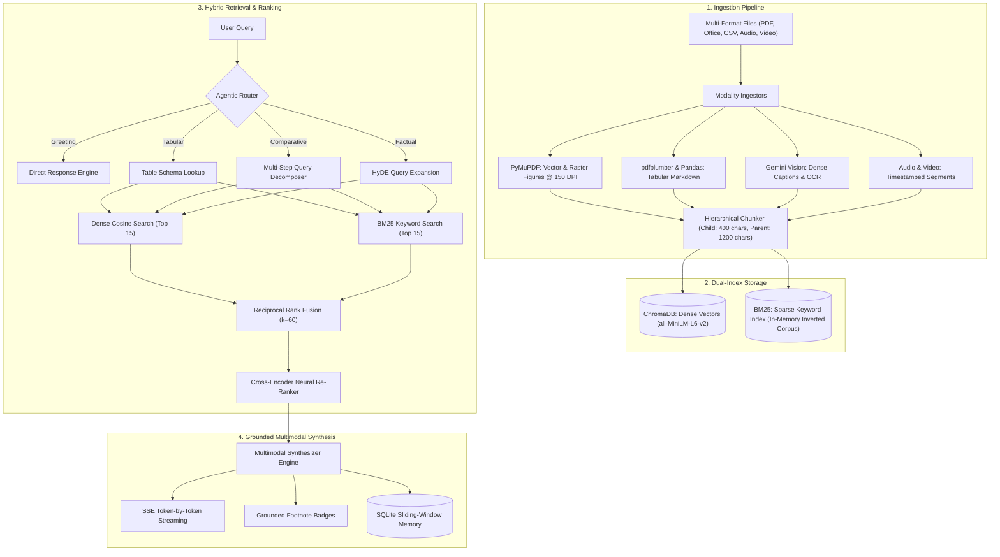

# NexusRAG

A multimodal retrieval-augmented generation engine with hybrid search, visual chart extraction, and grounded footnote citations.

[](https://www.python.org/)
[](https://fastapi.tiangolo.com/)
[](https://react.dev/)
[](https://www.typescriptlang.org/)
[](LICENSE)
[](tests/test_offline_suite.py)

---

## Overview

Most RAG tutorials assume documents are clean, contiguous text files. Real-world documents—financial filings, technical whitepapers, architectural specs, and slide decks—are full of high-density diagrams, numerical tables, multi-column layouts, and audio/video recordings. When fed into naive text splitters, visual charts get stripped, tables lose row/column relationships, and the LLM produces answers with generic or hallucinated citations.

NexusRAG is a local-first multimodal RAG system designed to ingest, index, and reason across complex mixed-format archives. It extracts diagrams at 150 DPI, parses spreadsheet grids into markdown schemas, fuses dense vector embeddings with sparse BM25 keyword search using Reciprocal Rank Fusion (RRF), and generates streaming answers with interactive footnote citations linking directly to high-resolution figures and source page excerpts.

---

## Architecture

```text
[Multi-Format Ingestion]
  PDF / Word / Slides / CSV / Audio / Video
       │
       ├── Text Chunks ──────────┐
       ├── Extracted Figures ────┼──► [Parent-Child Chunker]
       └── Tabular Markdown ─────┘           │
                                             ▼
                                    [Dual-Index Storage]
                                    ├── ChromaDB (Dense)
                                    └── BM25Okapi (Sparse)
                                             │
[User Query]                                 │
     │                                       ▼
[Agent Router] ─────────────────────► [Hybrid Retrieval]
 (Direct / Retrieval / Multi-step)           │
                                             ├── Dense Cosine (Top 15)
                                             └── BM25 Scores (Top 15)
                                                     │
                                                     ▼
                                          [Reciprocal Rank Fusion]
                                                     │
                                                     ▼
                                          [Cross-Encoder Reranker]
                                                     │
                                                     ▼
[React SPA] ◄──── SSE Token Stream ◄──── [Multimodal Synthesizer]
(Footnotes + Marginalia Drawer)           (Gemini + Context + Visual Figures)
```



---

## Key Capabilities

- **Multi-Format Ingestion**: Supports 17 file formats (`.pdf`, `.docx`, `.pptx`, `.csv`, `.xlsx`, `.png`, `.jpg`, `.webp`, `.mp3`, `.wav`, `.m4a`, `.mp4`, `.webm`, `.mov`).
- **Diagram & Figure Extraction**: Automatically isolates vector drawings and raster images from multi-page PDFs at 150 DPI and captions them using Gemini Vision OCR for semantic indexing.
- **Hierarchical Parent-Child Chunking**: Generates small 400-character child chunks for fine-grained retrieval, while preserving references to 1200-character parent context blocks to maintain synthesis coherence.
- **Hybrid Search via Reciprocal Rank Fusion (RRF)**: Combines dense 384-dimensional semantic embeddings (`all-MiniLM-L6-v2`) with sparse BM25Okapi keyword matching ($k=60$) to handle both semantic queries and exact keyword/acronym lookups.
- **Cross-Encoder Re-Ranking**: Evaluates top-20 candidate chunks through a cross-encoder (`ms-marco-MiniLM-L-6-v2`) to eliminate false-positive semantic matches before generation.
- **Agentic Routing & HyDE**: Dynamically classifies query intent into `DIRECT`, `RETRIEVAL`, `MULTI_STEP` decomposition, and `TABLE_LOOKUP`, applying Hypothetical Document Embeddings (HyDE) when queries benefit from zero-shot expansion.
- **Interactive Citations & Marginalia**: Generated answers include explicit citation badges (`[Doc 1 (Pg 2)]`, `[Fig. 1 (Pg 3)]`, `[Table 1]`, `[Audio 1]`) that open a slide-out Marginalia drawer displaying the original high-resolution figure or text excerpt.
- **Outage Resilience (503/504 Handling)**: If upstream LLM providers encounter transient 503 Service Unavailable or 504 Gateway Timeout errors, NexusRAG catches the exception and falls back to an extractive answer directly from top retrieved citations, keeping the SSE connection intact.
- **Persistent Sliding Memory**: Backed by SQLite (`chat_history.db`), retaining the last 4 full turns in immediate context alongside rolling asynchronous summaries for extended sessions.

---

## Design Decisions & Trade-Offs

### 1. Reciprocal Rank Fusion (RRF) over Linear Score Blending
Dense vector similarity produces cosine scores bounded between 0.0 and 1.0, while BM25 produces unbounded positive relevance scores dependent on query length and term frequencies. Combining them via linear interpolation ($\alpha \cdot \text{dense} + (1-\alpha) \cdot \text{sparse}$) requires ad-hoc score normalization that frequently breaks across different document collections.

NexusRAG uses **Reciprocal Rank Fusion (RRF)**:

$$\text{RRF\_score}(d) = \sum_{m \in \{\text{dense}, \text{sparse}\}} \frac{w_m}{k + \text{rank}_m(d)}$$

Where $k=60$, $w_{\text{dense}}=0.6$, and $w_{\text{sparse}}=0.4$. RRF operates strictly on relative rankings rather than raw score magnitudes, providing robust retrieval performance across collections without manual score calibration.

### 2. Parent-Child Chunking over Fixed-Size Chunking
Fixed chunk sizes introduce an inherent dilemma:
- **Small chunks (200–400 chars)**: Maximize vector embedding specificity, but lack sufficient surrounding context for the LLM to generate nuanced answers.
- **Large chunks (1000–2000 chars)**: Provide ample context, but dilute vector embeddings with unrelated sentences, degrading retrieval precision.

NexusRAG resolves this by embedding 400-character child chunks into ChromaDB and linking each child via UUID to a 1200-character parent chunk. When a child chunk matches a query, its parent block is injected into the synthesizer prompt.

### 3. Persistent SQLite Sliding Window over Unbounded Context
Dumping full conversation history into the context window increases latency, inflates token costs, and causes model "distraction" on older turns. NexusRAG implements a SQLite-backed sliding window keeping the 4 most recent turns verbatim in context, with older turns summarized into a running session buffer.

### 4. 100% Offline Test Suite
To prevent test suite failures during upstream API outages (such as Gemini 503/504 status codes or rate limits), core algorithmic modules—chunking boundaries, BM25 indexing, RRF calculation, router heuristics, SQLite memory, and FastAPI endpoints—are verified using a dedicated offline test suite with zero external network calls.

---

## Architecture Comparison

| Dimension | Standard / Naive RAG | NexusRAG Architecture |
|---|---|---|
| **Supported Modalities** | Plain `.txt` or raw text `.pdf` | 17 formats (PDF, DOCX, PPTX, CSV, XLSX, Audio, Video, Images) |
| **Figures & Charts** | Stripped and discarded | Extracted at 150 DPI, captioned via Vision OCR, viewable in Lightbox |
| **Spreadsheets & Tables** | Flattened into unstructured text | Converted to clean Markdown tables with column schema preservation |
| **Chunking Architecture** | Fixed token count | Hierarchical Parent-Child (400-char retrieval / 1200-char synthesis) |
| **Retrieval Algorithm** | Vector search only | Hybrid Search: ChromaDB (Dense) + BM25Okapi (Sparse) via RRF ($k=60$) |
| **Re-Ranking** | None (raw top-$k$ cosine) | Cross-Encoder neural re-ranking on fused candidate pool |
| **Attribution & Footnotes** | Generic or hallucinated file mentions | Verifiable footnotes (`[Doc X (Pg Y)]`, `[Fig. X]`) with drawer inspection |
| **Streaming Protocol** | Blocking HTTP or raw text | Structured Server-Sent Events (`route` $\rightarrow$ `token` $\rightarrow$ `done`) |
| **Upstream API Resilience** | Crashes on 503/504 status | Automatic grounded fallback from top retrieved citations |
| **Test Suite Execution** | Relies on live API keys | 100% offline verification in 0.03 seconds |

---

## Quickstart

### Option 1: Docker (Recommended)

```bash
# 1. Clone repository
git clone https://github.com/Driv1216/NexusRag.git
cd NexusRag

# 2. Configure environment
cp .env.example .env
# Add your GOOGLE_API_KEY to .env

# 3. Start container
docker compose up --build
```

Access the application at `http://localhost:8000`.

---

### Option 2: Local Development

#### Prerequisites
- Python 3.11+
- Node.js 20+ and npm
- Google Gemini API Key

#### 1. Setup Python Environment
```bash
git clone https://github.com/Driv1216/NexusRag.git
cd NexusRag

python3 -m venv .venv
source .venv/bin/activate

pip install -r requirements.txt
cp .env.example .env
# Add your GOOGLE_API_KEY to .env
```

#### 2. Build Frontend SPA
```bash
cd frontend
npm ci
npm run build
cd ..
```

#### 3. Start API Server
```bash
uvicorn backend.main:app --host 0.0.0.0 --port 8000 --reload
```

Open `http://localhost:8000` in your browser.

---

## Testing

Run the 100% offline test suite:

```bash
python3 -m unittest tests/test_offline_suite.py -v
```

All 8 tests run locally in ~0.03s without calling external APIs:

```
test_01_hierarchical_chunking_parent_child ... ok
test_02_tabular_markdown_chunking ... ok
test_03_bm25_tokenization_and_search ... ok
test_04_reciprocal_rank_fusion_math ... ok
test_05_agent_query_router_heuristic_paths ... ok
test_06_sqlite_conversation_memory ... ok
test_07_pydantic_data_contracts ... ok
test_08_fastapi_rest_endpoints_offline ... ok

Ran 8 tests in 0.034s
OK
```

---

## API Reference

| Method | Endpoint | Description | Payload / Parameters |
|---|---|---|---|
| `GET` | `/api/health` | Healthcheck and active engine configuration | None |
| `GET` | `/api/documents` | List all ingested documents and metadata | None |
| `GET` | `/api/gallery` | Retrieve extracted visual figures and diagrams | None |
| `POST` | `/api/upload` | Upload and ingest document | `multipart/form-data` (`file`) |
| `POST` | `/api/query` | Synchronous multimodal query | `{"question": "...", "top_k": 5}` |
| `POST` | `/api/query/stream` | Real-time SSE token stream | `QueryRequest` JSON |
| `GET` | `/api/sessions/{session_id}` | Retrieve multi-turn chat history | Path parameter `session_id` |
| `POST` | `/api/evaluate` | Run LLM-as-a-Judge benchmark | `{"test_questions": [...]}` |
| `GET` | `/api/evaluate/results` | Retrieve past benchmark scores | None |

---

## Project Structure

```
NexusRag/
├── .github/
│   ├── workflows/ci.yml         # GitHub Actions CI workflow
│   ├── ISSUE_TEMPLATE/          # Issue templates
│   └── PULL_REQUEST_TEMPLATE.md # PR checklist
├── backend/
│   ├── agent/                   # Engine, router, memory, synthesizer, rewriter
│   ├── embeddings/              # Dense vector and CLIP embeddings
│   ├── evaluation/              # Academic RAG evaluation metrics & judge
│   ├── ingestion/               # Multi-format ingestors (PDF, Office, Sheet, Audio, Video)
│   ├── retrieval/               # ChromaDB store, BM25Okapi store, RRF, Cross-Encoder
│   ├── vision/                  # Vision captioner & diagram OCR
│   ├── config.py                # System settings and paths
│   ├── models.py                # Pydantic v2 data schemas
│   └── main.py                  # FastAPI application and SSE endpoints
├── frontend/
│   ├── src/                     # React 18, TypeScript, Tailwind CSS SPA
│   ├── package.json
│   └── vite.config.ts
├── tests/
│   ├── test_offline_suite.py    # 100% offline verification suite
│   └── test_nexus_suite.py      # Integration test suite
├── Dockerfile                   # Multi-stage container build
├── docker-compose.yml           # Local container orchestration
├── requirements.txt             # Python dependencies
├── portfolio.md                 # Technical case study & architecture notes
├── .env.example                 # Environment configuration template
└── README.md
```

---

## License

Distributed under the [MIT License](LICENSE).
